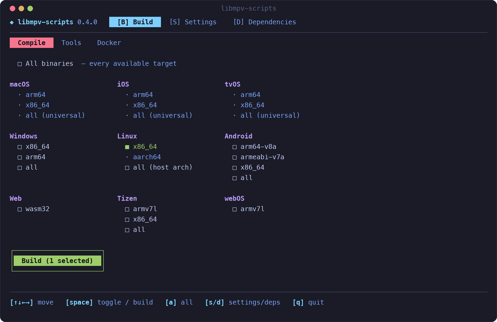
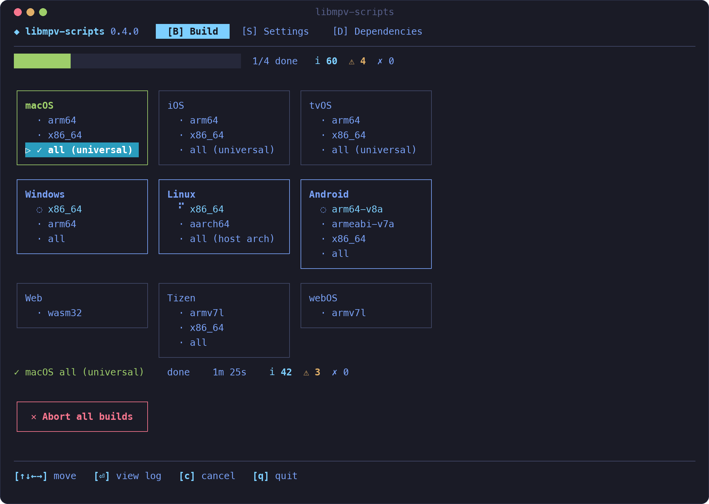
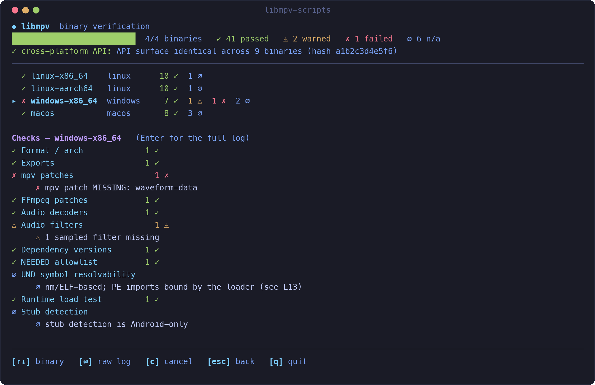
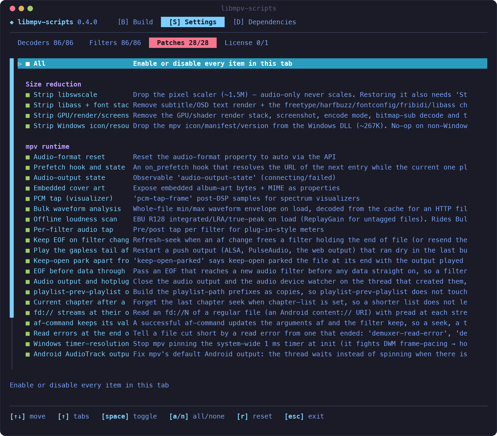
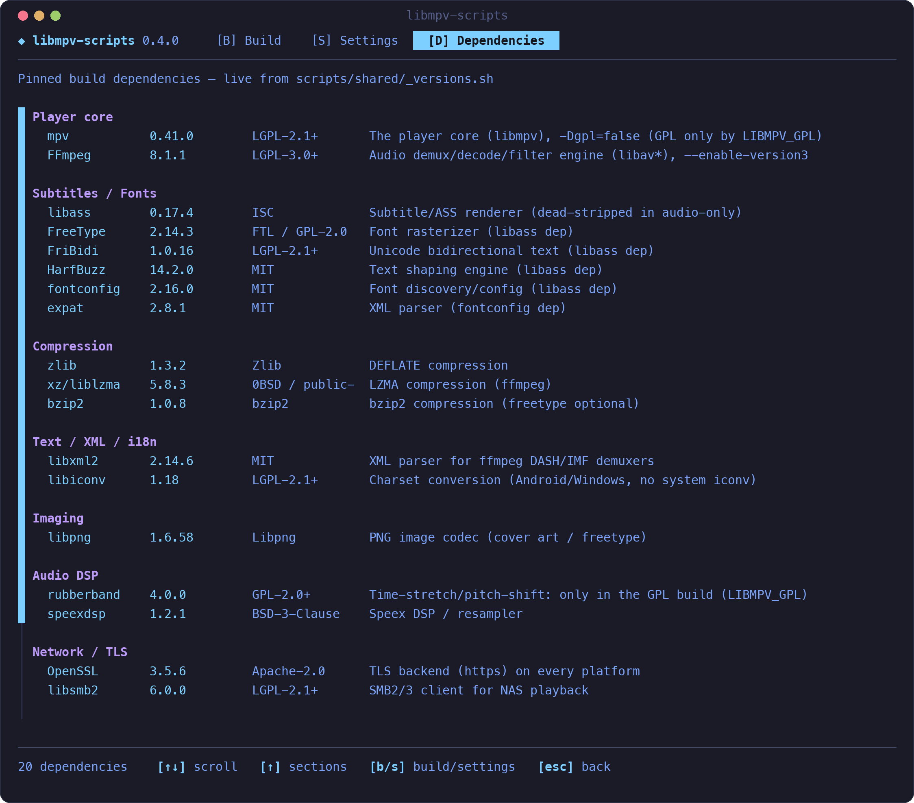
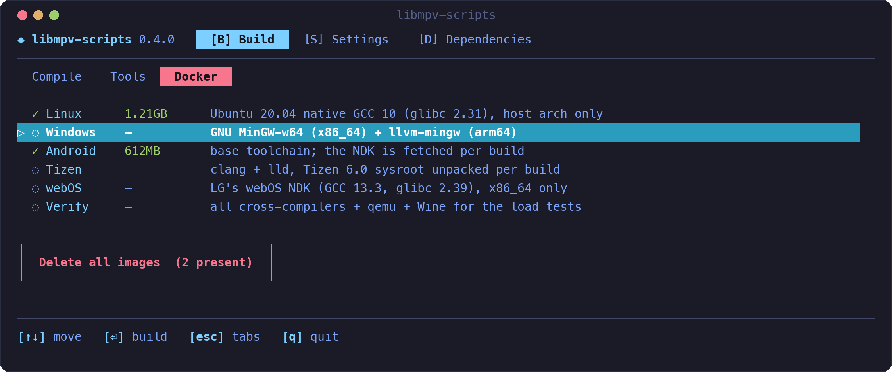

# libmpv-scripts

#### Audio-only libmpv, built for every platform.

[](CHANGELOG.md)
[]()
[]()
[](LICENSE)
[](https://github.com/ales-drnz/libmpv-scripts)
[](https://discord.gg/g2Qf4Mq9MP)
[](https://www.patreon.com/cw/ales_drnz)
[](https://www.buymeacoffee.com/ales.drnz)

The build scripts for the libmpv inside [`mpv_audio_kit`](https://pub.dev/packages/mpv_audio_kit). They compile [mpv](https://mpv.io) and FFmpeg without video, with a set of patches the package relies on (waveform, loudness scan, audio taps and more), for macOS, iOS, tvOS, Android, Windows, Linux, the Tizen and webOS TVs, and the browser.

Everything runs from `./build`, a terminal menu where you pick the targets and follow the builds.

---

## Quick start

```bash
git clone https://github.com/ales-drnz/libmpv-scripts
cd libmpv-scripts
./build
```

On Windows use `build.cmd`. You need Go, plus Docker for Linux, Windows, Android, Tizen and webOS, Xcode for Apple targets, and the emsdk for the web.

---

## What it produces

| Platform | Architectures | File in `builds/release/` |
| :--- | :--- | :--- |
| macOS | arm64 and x86_64 (universal) | `libmpv_macos.xcframework.zip` |
| iOS | arm64 device, arm64 and x86_64 simulator | `libmpv_ios.xcframework.zip` |
| tvOS | arm64 device, arm64 and x86_64 simulator | `libmpv_tvos.xcframework.zip` |
| Android | arm64-v8a, armeabi-v7a, x86_64 | `libmpv_android-<abi>.so` |
| Linux | x86_64, aarch64 | `libmpv_linux-<arch>.so` |
| Windows | x86_64, arm64 | `libmpv_windows-<arch>.dll` |
| Tizen | armv7l for the TVs, x86_64 for the TV emulator | `libmpv_tizen-<arch>.so` |
| webOS | armv7l | `libmpv_webos-armv7l.so` |
| Web | wasm32 with threads | `libmpv_web.zip` |

- **API**: only `mpv_*`, plus the `mak_pcm_*` functions that feed live PCM to the `mak-pcm` protocol. On the web the module also exports the `mak_web_*`, `mak_wa_*` and `mak_webio_*` calls of its glue, and `malloc` and `free`. No video decoders.
- **Linux and Android**: the SONAME is `libmpv_audio_kit.so`, so it can live next to another plugin's libmpv. Linux needs glibc 2.31 and ALSA; PipeWire (0.3.57 or later) and PulseAudio are loaded only when installed.
- **Tizen**: the same SONAME. It needs Tizen 6.0, the TVs from 2021 on, and its glibc 2.30. The only audio output is `ao_tizen`, on the system's `capi-media-audio-io` and `capi-media-sound-manager`. libgcc and libstdc++ are linked in.
- **webOS**: the same SONAME. It needs webOS 26 and its glibc 2.39, ALSA and the system's libstdc++. The audio output is ALSA.
- **Web**: Emscripten 6.0.12 with pthreads. The zip holds `libmpv.mjs`, `libmpv.wasm`, the AudioWorklet `mak_webaudio_processor.js` and `build_web.json`. The page must be cross-origin isolated (COOP and COEP). A server of another origin must send CORS headers and expose `Content-Range`, or a server that caps each answer cuts the file. The memory starts at 32 MB and grows to 2 GB; a client can pass a smaller shared `wasmMemory`. No SMB.
- **Records**: each build leaves `build_<target>.json` (license, patches, filters) and its license texts. `./build manifest` turns them into `manifest.json` and `licenses.zip`, and fails when the libraries disagree.

Versions are set in `scripts/shared/_versions.sh`. `scripts/shared/_sources.sha256` pins every source by SHA-256 or by commit, and the web build's compiler on Linux x86_64.

---

## Licenses

This repository is BSD-3-Clause, except the files [`NOTICE`](NOTICE) lists.

The libraries are **LGPL-3.0-or-later**. An app of any license can link them. In short, the app must:

- ship the license texts (`THIRD_PARTY_LICENSES.txt` in `licenses.zip` is ready to ship);
- say that it uses libmpv under the LGPL;
- provide the source (`README.txt` in `licenses.zip` names every source);
- let the user replace the library.

Rubber Band is left out. `LIBMPV_GPL=1` builds it in, and the library becomes GPL-3.0-or-later. The details, the runtimes of each toolchain and what `licenses.zip` holds are in [`doc/licenses.md`](doc/licenses.md).

---

## Visuals

<p align="center">
  
</p>

<p align="center">
  
</p>

<p align="center">
  
</p>

<p align="center">
  
</p>

<p align="center">
  
</p>

<p align="center">
  
</p>

---

## Guide

### 1. Requirements

#### 1.1 Tools

| Tool | Needed for |
| :--- | :--- |
| [Go](https://go.dev/dl/) | always, it runs `./build` |
| [Docker](https://docs.docker.com/get-docker/) | Linux, Windows, Android, Tizen and webOS (Android on macOS builds without it) |
| Xcode | macOS, iOS and tvOS |
| [emsdk](https://emscripten.org/docs/getting_started/downloads.html) 6.0.12, meson and ninja | the web |

The Android NDK is downloaded by the build, you don't need to install it. So are the Tizen 6.0 packages of the Tizen sysroot. LG's webOS NDK is installed when the `webos` Docker image is built (see [3.4](#34-tizen-and-webos)).

#### 1.2 What each host can build

| Host | Targets |
| :--- | :--- |
| macOS | all of them |
| Linux | all except macOS, iOS and tvOS |
| Windows | all except macOS, iOS, tvOS and the web |

Apple targets need a Mac, Linux builds only for the host's own architecture, and the web builds on the host with the emsdk. webOS builds in a `linux/amd64` container, because LG's NDK runs on x86_64 only. [GitHub Actions](#37-on-github-actions) builds everything, whatever you have.

#### 1.3 Folder layout

Building needs only this repo. Everything it produces lands in `builds/`: the libraries, `libmpv_web.zip` and `manifest.json` in `builds/release/`, the logs in `builds/logs/`.

---

### 2. The menu

Run `./build`. Arrow keys move, Space selects, Enter confirms, Q quits. The keys for each screen are listed at the bottom. There are three screens, switched with B, S and D.

#### 2.1 Build

Three tabs:

- **Compile**: pick platforms and architectures, then press Build. Each build shows its progress, time and warning count, and Enter opens its log.
- **Tools**: write `manifest.json` for the built libraries (Manifest), check them (Verify), and refresh the bundled CA certificates (Update CA).
- **Docker**: see, build or delete the Docker images. The image a build needs is created automatically the first time.

#### 2.2 Settings

Choose which audio decoders, audio filters and patches go into the build, and in the License tab whether to make the GPL build (see [Licenses](#licenses)). Fewer decoders and filters make a smaller library, but a format you remove won't play. Your choices are saved separately from the defaults, and you can reset them at any time.

#### 2.3 Dependencies

The main libraries of the build, with their version and license; the complete list for each target, with SPDX ids, is in its `THIRD_PARTY_LICENSES.txt`. Rubber Band is only in the GPL build.

---

### 3. Building

#### 3.1 macOS, iOS and tvOS

On a Mac with Xcode:

```bash
./build macos          # universal xcframework
./build ios            # device and simulator xcframework
./build tvos           # the same for tvOS
./build macos-arm64    # one architecture
```

#### 3.2 Linux and Windows

Both build in Docker. Linux builds natively on Ubuntu 20.04, for the glibc 2.31 floor, so an x86_64 host builds `linux-x86_64` and an arm64 host builds `linux-aarch64`. Windows cross-compiles both architectures from any host:

```bash
./build linux-x86_64   # on an x86_64 host
./build windows        # x86_64 and arm64
```

#### 3.3 Android

On macOS it builds directly on the host, which is the fastest option. Elsewhere it builds in Docker. The Docker tab can force Docker on macOS too.

```bash
./build android                  # all three ABIs
./build android-arm64-v8a        # one ABI
```

#### 3.4 Tizen and webOS

Both build in Docker, from any host:

```bash
./build tizen            # armv7l and x86_64
./build tizen-armv7l     # the TVs only
./build webos-armv7l
```

The `tizen` image has clang and lld. Each build unpacks a sysroot of Tizen 6.0 packages from download.tizen.org, every package checked against `scripts/tizen/tizen_sysroot.sha256`.

The `webos` image downloads LG's webOS NDK 11.2.0 from LG's release, checks its SHA-256 and runs its installer with `-y`, which accepts LG's licence. That licence allows the NDK on your own machines only: do not push the image, and do not publish the NDK or its sysroot. The Build workflow builds the image without the Actions cache for the same reason. `./build verify` takes the TVs' sysroot out of the same installer, into `builds/work/webOS/ndk/`, to check the webOS library.

#### 3.5 Web

On a Linux or macOS host, with the emsdk at 6.0.12 (`./emsdk install 6.0.12 && ./emsdk activate 6.0.12`) and meson and ninja on the `PATH`:

```bash
EMSDK=path/to/emsdk ./build web
```

It builds FFmpeg, mpv and their dependencies as WebAssembly archives in `builds/work/Web/`, then links the module into `builds/release/libmpv_web/` and packs it into `builds/release/libmpv_web.zip`. `scripts/build_libmpv_web.sh` takes the same variables as the other builds, plus `STAGE=link` to relink only.

#### 3.6 From the command line

`./build` accepts targets as arguments and runs them in order, stopping at the first failure:

```bash
./build all            # everything this host can build except the web, then the manifest
./build macos verify   # build macOS, then verify it
./build list           # every target
```

These variables are passed to the Docker builds:

| Variable | Effect |
| :--- | :--- |
| `JOBS=N` | parallel jobs, all cores by default |
| `ENABLE_LTO_DEPS=0` | turn off link-time optimization for the dependencies |
| `FORCE_DOWNLOAD=1` | download the sources again |
| `KEEP_BUILD=1` | keep the build folders |
| `WIPE_ALL=1` | also delete the downloaded sources |
| `LIBMPV_GPL=1` | the GPL build with Rubber Band (see [Licenses](#licenses)) |

`STRICT_SOURCES=1` and `RECORD_SOURCES=<file>` apply to the builds on the host (macOS, iOS, tvOS, web, and Android on a Mac) and to CI. The first stops on a source that is not pinned, the second appends the line of every unpinned source to a file.

To build another version of a dependency, set `MPV_VERSION`, `FFMPEG_VERSION` and so on (see `scripts/shared/_versions.sh`). This works for a build on the host or a build script run directly: `./build` does not pass them to Docker.

#### 3.7 On GitHub Actions

Every push to a `release/` branch runs `.github/workflows/build.yml` with `STRICT_SOURCES=1`:

- its first job, `release-branch`, stops the run when `LIBMPV_RELEASE` is not of the form `rN`, or not the `rN` of a `release/rN` branch;
- it builds all thirteen libraries and the web module, Apple included;
- it uploads them as the `libmpv-release` artifact, with the records, `licenses.zip` and `manifest.json`;
- it runs `./build verify`, the patch tests, a tone with the Linux library in a bare Debian 11, and the web checks in Node and Chrome;
- beside the release, without holding it back, it runs lint, the tests of the TUI and of `verify/tests`, the web checks in Firefox and the web build with AddressSanitizer.

A build stopped by an unpinned source uploads the line to add as an `unpinned-sources-<job>` artifact.

---

### 4. Using the binaries

#### 4.1 Installing into mpv_audio_kit

`mpv_audio_kit` gets libmpv through a build hook (`hook/build.dart`). When an app builds, the hook downloads the library for the target from the package's `libmpv-rN` GitHub release and checks its SHA-256. To point the package at a release, run this in `mpv_audio_kit`:

```bash
scripts/update_libmpv.sh r24                        # a published release
scripts/update_libmpv.sh r24 path/to/manifest.json  # before publishing it
```

It writes the release into `lib/src/internals/libmpv_release.dart` and the hashes from `manifest.json` into the hook, installs the web module of `libmpv_web.zip` in `web/` once its hashes and ABI check, and copies the manifest to `tool/codegen`. Before publishing, `libmpv_web.zip` and `licenses.zip` must sit beside `manifest.json`, as they do in the Build's `libmpv-release` artifact.

#### 4.2 Local or downloaded libraries

To try a local build in an app, point the hook at the file in the app's `pubspec.yaml`. The file is bundled as it is, without a checksum:

```yaml
hooks:
  user_defines:
    mpv_audio_kit:
      libmpv: path/to/libmpv_linux-x86_64.so
```

Manifest in the Tools tab, or `./build manifest`, writes `builds/release/manifest.json` for a local build, ready for `update_libmpv.sh`.

#### 4.3 Verifying

`./build verify` checks every library in `builds/release/`: architecture, API, patched properties, decoders and filters, no video code, dependencies and license. Where the host can load a library, it calls into it.

The patches, the network protocols and the web module have tests of their own. Their commands and requirements are in [`verify/README.md`](verify/README.md).

#### 4.4 Publishing a release

1. Build all thirteen libraries and the web module, usually by pushing a `release/rN` branch (see [3.7](#37-on-github-actions)).
2. Create the `libmpv-rN` release on `mpv_audio_kit` and upload the libraries, `libmpv_web.zip`, `licenses.zip` and `manifest.json`.
3. In `mpv_audio_kit`, run `scripts/update_libmpv.sh rN`.

---

### 5. How it works

`./build` is a small Go program ([Bubble Tea](https://github.com/charmbracelet/bubbletea)) that runs the shell scripts in `scripts/`, one per platform. Apple targets build with Xcode on the host, the web with the emsdk on the host. Linux, Windows, Android, Tizen and webOS build inside a Docker image from `docker/Dockerfile`, which has one stage per platform, so you only keep the toolchains you use.

Each build downloads the pinned sources, applies the patches in `patches/` to mpv and FFmpeg, compiles only the audio parts, and strips the library down to the `mpv_*` and `mak_pcm_*` API. Every patch finds its place by exact text and stops the build if upstream has changed underneath it.

---

## Troubleshooting

- **"Go not found"**: install Go and run again.
- **A Linux, Windows, Android, Tizen or webOS build fails right away**: Docker isn't running.
- **macOS, iOS and tvOS are greyed out**: they need a Mac with Xcode. GitHub Actions can build them instead.
- **The first Docker build is slow**: it is building the image, later builds reuse it.
- **"Unpinned source"**: a download is not in `scripts/shared/_sources.sha256`. Add the line the error prints, or collect the lines with `RECORD_SOURCES=<file>` in a build on the host. In CI they are uploaded as an `unpinned-sources-<job>` artifact.
- **"the Linux build is native-only"**: Linux builds only for the host's architecture. Use a host of the other architecture, or GitHub Actions.
- **Android in Docker is slow on Apple Silicon**: the NDK is x86_64 only. Build on the host (the default), or turn on Rosetta in Docker Desktop.

---

## Project background

The build pipeline, the Go TUI and the patches for mpv and FFmpeg were written with Claude Code.

---

*Developed by Alessandro Di Ronza*
