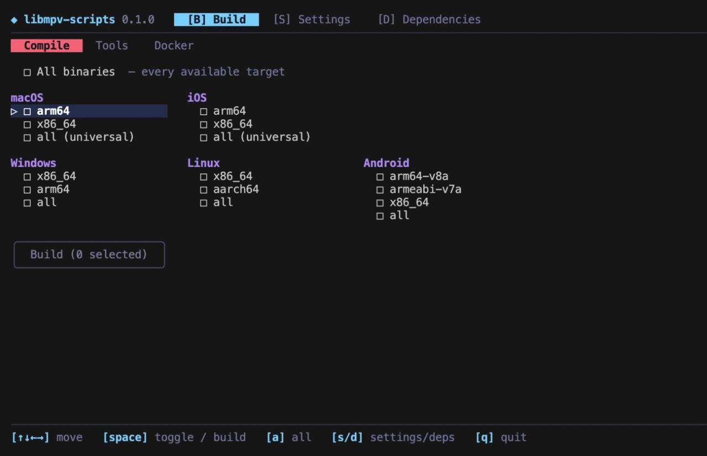

# libmpv-scripts

#### Audio-only libmpv, built for every platform.

[](CHANGELOG.md)
[]()
[]()
[](LICENSE)
[](https://github.com/ales-drnz/libmpv-scripts)
[](https://discord.gg/g2Qf4Mq9MP)
[](https://www.patreon.com/cw/ales_drnz)
[](https://www.buymeacoffee.com/ales.drnz)

The build scripts for the libmpv inside [`mpv_audio_kit`](https://pub.dev/packages/mpv_audio_kit). They compile [mpv](https://mpv.io) and FFmpeg without video, with a set of patches the package relies on (waveform, loudness scan, audio taps and more), for macOS, iOS, Android, Windows, Linux and the browser.

Everything runs from `./build`, a terminal menu where you pick the targets and follow the builds.

---

## Quick start

```bash
git clone https://github.com/ales-drnz/libmpv-scripts
cd libmpv-scripts
./build
```

On Windows use `build.cmd`. You need Go, plus Docker for Linux, Windows and Android, Xcode for Apple targets, and the emsdk for the web.

---

## What it produces

| Platform | Architectures | File in `builds/release/` |
| :--- | :--- | :--- |
| macOS | arm64 and x86_64 (universal) | `libmpv_macos.xcframework.zip` |
| iOS | arm64 device, arm64 and x86_64 simulator | `libmpv_ios.xcframework.zip` |
| Android | arm64-v8a, armeabi-v7a, x86_64 | `libmpv_android-<abi>.so` |
| Linux | x86_64, aarch64 | `libmpv_linux-<arch>.so` |
| Windows | x86_64, arm64 | `libmpv_windows-<arch>.dll` |
| Web | wasm32 with threads | `libmpv_web.zip` |

Each library exports only the `mpv_*` C API, plus the `mak_pcm_*` functions that feed live PCM to the `mak-pcm` protocol, and carries no video decoders. On Linux and Android its SONAME is `libmpv_audio_kit.so`, so it can live next to another plugin's libmpv. The Linux one needs glibc 2.31 or later and ALSA (`libasound.so.2`). It loads PipeWire and PulseAudio only when they are installed, through stubs made with Implib.so (vendored in `tools/implib`), and skips a PipeWire older than 0.3.57 in favour of PulseAudio, then ALSA.

The web module is WebAssembly built with Emscripten 6.0.12 and pthreads. `libmpv_web.zip` holds `libmpv.mjs` (the ES module that loads `libmpv.wasm` from beside itself), `libmpv.wasm`, `mak_webaudio_processor.js` (the AudioWorklet of its `webaudio` output, loaded from beside `libmpv.mjs`) and its record `build_web.json`. It has the shared patches, the decoders and the filters of the libraries, without the render API, SMB and the embedded CA bundle: http, https and `blob:` URLs go through the browser's fetch, so a server of another origin must send CORS headers. A page that loads it must be cross-origin isolated (COOP and COEP headers on every file). `mak_web_abi_version()` returns the version of what a client relies on (exports, struct layout, the wakeup bridge, `Module.makWebAudio`); `build_web.json` and the manifest list it.

The versions of mpv, FFmpeg and every other dependency are set in `scripts/shared/_versions.sh`, and `scripts/shared/_sources.sha256` pins each source tarball by its SHA-256 and each git source (libplacebo, libsmb2, PipeWire) by the commit of its tag. Each build leaves next to its library a record of its license, the patches it applied and the audio filters it compiled (`builds/release/build_<target>.json`), and the license texts of what it links (`builds/release/licenses_<target>/`). The Manifest action turns them into `builds/release/manifest.json`, with the versions, the license, the filters, the patches of every target, the commit and run of the build and the hash of every library, and packs the texts into `licenses.zip`. It fails when the libraries disagree on the license or the filters, or one has no record or no license texts.

---

## Licenses

This repository is BSD-3-Clause ([`LICENSE`](LICENSE)), except the files [`NOTICE`](NOTICE) lists: `patches/ffmpeg/libsmb2.c` and `patches/ffmpeg/webio/webio.c`, which become FFmpeg protocols (the second with code adapted from FFmpeg's `http.c`), `patch_strip_libass.py`, `patch_strip_mpv_dead.py` and `patch_swscale_optional.py` of `patches/mpv/shared/` and `patch_ios_audio_stubs.py` of `patches/mpv/ios/`, which write code that reproduces mpv code, and `patches/mpv/android/audiotrack_read_insert.c` and `patches/mpv/shared/prefetch/mak_prefetch_insert.c`, which adapt mpv code, are LGPL-2.1-or-later like mpv and FFmpeg (text: [`LICENSE.LGPL-2.1`](LICENSE.LGPL-2.1)); `tools/implib/` (Implib.so) is MIT; the Mozilla CA bundle `patches/ffmpeg/embed_cacert/cacert.pem` is MPL-2.0. The lines of mpv, FFmpeg and Rubber Band that the other patch scripts quote to find where they apply stay under the license of their project, and so does every file a patch changes in an upstream tree. Code of mpv or FFmpeg that a file of this repository adapts (not only quotes) is LGPL-2.1-or-later, and NOTICE lists that file.

The libraries the scripts build are **LGPL, version 3 or later**: mpv is built with `-Dgpl=false`, which leaves out the files mpv's `Copyright` lists as GPL-only, for the LGPLv2.1+ libmpv that file describes, FFmpeg without `--enable-gpl` and with `--enable-version3`, because OpenSSL 3 is under the Apache-2.0, which is not compatible with the LGPL v2.1 but is with version 3, and every other dependency is under a permissive or LGPL license, the embedded Mozilla CA bundle under the MPL-2.0. In short (the texts are the terms): the LGPLv3 lets an app link the library whatever the app's own license, on its conditions. Among them: the app ships the license texts; it says that it uses libmpv and that libmpv is under the LGPL; it provides the source of the library it ships (`README.txt` in `licenses.zip` names the commit of this repository and every upstream source); and it lets the user replace the library with one built from modified source. Every target ships libmpv as a separate dynamic library or module. Whether a given app meets these conditions on a given platform depends on how it is distributed, and this repository makes no promise about it.

The texts are in `licenses.zip`, published with the libraries: one folder per target with the texts of mpv, FFmpeg and each library the build compiles and links into it (those of the versions built, taken from their source trees; the runtime libraries of the toolchain, such as Android's libc++ or Emscripten's system libraries, are not included), the notice of the embedded Mozilla CA bundle, on Windows the license of the mingw-w64 winpthreads linked into the DLL, this repository's `LICENSE`, `LICENSE.LGPL-2.1` and `NOTICE`, a `README.txt` naming the commit of this repository and the URL and SHA-256 (or commit) of each source the build downloaded, and `THIRD_PARTY_LICENSES.txt`: all those texts in one plain-text file, each component under a heading with its name, version and SPDX license id, for an app to ship as it is, without reading the folders (the ids are a guide, the texts are the terms). `manifest.json` names the license (`"license": "LGPL-3.0-or-later"`).

Rubber Band (librubberband, GPL-2.0+) is left out, and with it FFmpeg's `rubberband` filter and mpv's `af=rubberband`. Pitch and tempo stay available through mpv's `pitch` and `speed` (`scaletempo2`) and the `atempo`, `asetrate` and `aresample` filters. For Rubber Band, build the libraries yourself with `LIBMPV_GPL=1` (or Settings ▸ License in the TUI): FFmpeg gets `--enable-gpl --enable-librubberband` and the `rubberband` filter, mpv `-Dgpl=true -Drubberband=enabled`, and every platform builds librubberband. Such a library is **GPL, version 3 or later**: an app that ships it is, as a whole, under the terms of the GPLv3, source included. Its record, manifest and texts say `GPL-3.0-or-later`. The release workflow (`.github/workflows/build.yml`) does not set it, and `./build verify` fails a library that should be LGPL but has `gpl` or `rubberband` among mpv's features. Clean `builds/work/` after switching, or the build stops on stages built with the other setting.

---

## Contents

*   [Quick start](#quick-start)
*   [What it produces](#what-it-produces)
*   [Licenses](#licenses)
*   [Visuals](#visuals)
*   [Guide](#guide)
    <details>
    <summary><a href="#1-requirements"><b>1. Requirements</b></a></summary>

    * [1.1 Tools](#11-tools)
    * [1.2 What each host can build](#12-what-each-host-can-build)
    * [1.3 Folder layout](#13-folder-layout)

    </details>

    <details>
    <summary><a href="#2-the-menu"><b>2. The menu</b></a></summary>

    * [2.1 Build](#21-build)
    * [2.2 Settings](#22-settings)
    * [2.3 Dependencies](#23-dependencies)

    </details>

    <details>
    <summary><a href="#3-building"><b>3. Building</b></a></summary>

    * [3.1 macOS and iOS](#31-macos-and-ios)
    * [3.2 Linux and Windows](#32-linux-and-windows)
    * [3.3 Android](#33-android)
    * [3.4 Web](#34-web)
    * [3.5 From the command line](#35-from-the-command-line)
    * [3.6 On GitHub Actions](#36-on-github-actions)

    </details>

    <details>
    <summary><a href="#4-using-the-binaries"><b>4. Using the binaries</b></a></summary>

    * [4.1 Installing into mpv_audio_kit](#41-installing-into-mpv_audio_kit)
    * [4.2 Local or downloaded libraries](#42-local-or-downloaded-libraries)
    * [4.3 Verifying](#43-verifying)
    * [4.4 Publishing a release](#44-publishing-a-release)

    </details>

    <details>
    <summary><a href="#5-how-it-works"><b>5. How it works</b></a></summary>
    </details>
*   [Troubleshooting](#troubleshooting)
*   [Project background](#project-background)

---

## Visuals

<p align="center">
  
</p>

---

## Guide

### 1. Requirements

#### 1.1 Tools

| Tool | Needed for |
| :--- | :--- |
| [Go](https://go.dev/dl/) | always, it runs `./build` |
| [Docker](https://docs.docker.com/get-docker/) | Linux, Windows and Android (Android on macOS builds without it) |
| Xcode | macOS and iOS |
| [emsdk](https://emscripten.org/docs/getting_started/downloads.html) 6.0.12, meson and ninja | the web |

The Android NDK is downloaded by the build, you don't need to install it.

#### 1.2 What each host can build

| Host | Targets |
| :--- | :--- |
| macOS | all of them |
| Linux | all except macOS and iOS |
| Windows | all except macOS, iOS and the web |

Apple targets need a Mac, Linux builds only for the host's own architecture, and the web builds on the host with the emsdk. [GitHub Actions](#36-on-github-actions) builds everything, whatever you have.

#### 1.3 Folder layout

Building needs only this repo. Everything it produces lands in `builds/`: the libraries, `libmpv_web.zip` and `manifest.json` in `builds/release/`, the logs in `builds/logs/`.

---

### 2. The menu

Run `./build`. Arrow keys move, Space selects, Enter confirms, Q quits. The keys for each screen are listed at the bottom. There are three screens, switched with B, S and D.

#### 2.1 Build

Three tabs:

- **Compile**: pick platforms and architectures, then press Build. Each build shows its progress, time and warning count, and Enter opens its log.
- **Tools**: write `manifest.json` for the built libraries (Manifest), check them (Verify), and refresh the bundled CA certificates (Update CA).
- **Docker**: see, build or delete the Docker images. The image a build needs is created automatically the first time.

#### 2.2 Settings

Choose which audio decoders, audio filters and patches go into the build, and in the License tab whether to make the GPL build with Rubber Band (see [Licenses](#licenses)). Fewer decoders and filters make a smaller library, but a format you remove won't play. Your choices are saved separately from the defaults, and you can reset them at any time.

#### 2.3 Dependencies

The main libraries of the build, with their version and license; the complete list for each target, with SPDX ids, is in its `THIRD_PARTY_LICENSES.txt`. Rubber Band is only in the GPL build.

---

### 3. Building

#### 3.1 macOS and iOS

On a Mac with Xcode:

```bash
./build macos          # universal xcframework
./build ios            # device and simulator xcframework
./build macos-arm64    # one architecture
```

#### 3.2 Linux and Windows

Both build in Docker. Linux builds natively on Ubuntu 20.04, for the glibc 2.31 floor, so an x86_64 host builds `linux-x86_64` and an arm64 host builds `linux-aarch64`. Windows cross-compiles both architectures from any host:

```bash
./build linux-x86_64   # on an x86_64 host
./build windows        # x86_64 and arm64
```

#### 3.3 Android

On macOS it builds directly on the host, which is the fastest option. Elsewhere it builds in Docker. The Docker tab can force Docker on macOS too.

```bash
./build android                  # all three ABIs
./build android-arm64-v8a        # one ABI
```

#### 3.4 Web

On a Linux or macOS host, with the emsdk at 6.0.12 (`./emsdk install 6.0.12 && ./emsdk activate 6.0.12`) and meson and ninja on the `PATH`:

```bash
EMSDK=path/to/emsdk ./build web
```

It builds FFmpeg, mpv and their dependencies as WebAssembly archives in `builds/work/Web/`, then links the module into `builds/release/libmpv_web/` and packs it into `builds/release/libmpv_web.zip`. `scripts/build_libmpv_web.sh` takes the same variables as the other builds, plus `STAGE=link` to relink only. The checks of [4.3](#43-verifying) run it in Node and in a browser.

#### 3.5 From the command line

`./build` accepts targets as arguments and runs them in order, stopping at the first failure:

```bash
./build all            # everything this host can build, then the manifest
./build macos verify   # build macOS, then verify it
./build list           # every target
```

These variables are passed to the Docker builds:

| Variable | Effect |
| :--- | :--- |
| `JOBS=N` | parallel jobs, all cores by default |
| `ENABLE_LTO_DEPS=0` | turn off link-time optimization for the dependencies |
| `FORCE_DOWNLOAD=1` | download the sources again |
| `KEEP_BUILD=1` | keep the build folders |
| `WIPE_ALL=1` | also delete the downloaded sources |
| `STRICT_SOURCES=1` | stop on a source that is not pinned, as CI does |
| `RECORD_SOURCES=<file>` | append the hash of every unpinned source to a file |
| `LIBMPV_GPL=1` | the GPL build with Rubber Band (see [Licenses](#licenses)) |

To build another version of a dependency, set `MPV_VERSION`, `FFMPEG_VERSION` and so on (see `scripts/shared/_versions.sh`).

#### 3.6 On GitHub Actions

Every push to a `release/` branch runs `.github/workflows/build.yml`, which builds all nine libraries and the web module on GitHub's runners, Apple included, with `STRICT_SOURCES=1`. The run ends with a `libmpv-release` artifact holding the libraries, `libmpv_web.zip`, their build records and license texts, `licenses.zip` and `manifest.json`, then checks them as in [4.3](#43-verifying). It also plays a tone with the Linux x86_64 library in a bare Debian 11 container, without PipeWire and PulseAudio, runs the patch tests of [4.3](#43-verifying), and runs the checks of the web module in Node and in Chrome. The release waits for the patch tests and the web checks. A build stopped by an unpinned source uploads the line to add as an `unpinned-sources-<job>` artifact.

---

### 4. Using the binaries

#### 4.1 Installing into mpv_audio_kit

From 0.5.0, `mpv_audio_kit` gets libmpv through a build hook (`hook/build.dart`). When an app builds, the hook downloads the library for the target from the package's `libmpv-rN` GitHub release and checks its SHA-256. To point the package at a release, run this in `mpv_audio_kit`:

```bash
scripts/update_libmpv.sh r20                        # a published release
scripts/update_libmpv.sh r20 path/to/manifest.json  # before publishing it
```

It writes the release into `lib/src/internals/libmpv_release.dart` and the hashes from `manifest.json` into the hook, installs the web module of `libmpv_web.zip` in `web/` once its hashes and ABI check, and copies the manifest to `tool/codegen`. Before publishing, `libmpv_web.zip` must sit beside `manifest.json`, as it does in the Build's `libmpv-release` artifact.

#### 4.2 Local or downloaded libraries

To try a local build in an app, point the hook at the file in the app's `pubspec.yaml`. The file is bundled as it is, without a checksum:

```yaml
hooks:
  user_defines:
    mpv_audio_kit:
      libmpv: path/to/libmpv_linux-x86_64.so
```

The Manifest action in the Tools tab writes `builds/release/manifest.json` for a local build, ready for `update_libmpv.sh`.

#### 4.3 Verifying

`./build verify` checks every library in `builds/release/`: architecture, exported API, the patched mpv properties, the included decoders and filters, the spdif muxer and the httpproxy, https and tls protocols, that no video code slipped in, and the libraries it depends on, and the license: neither `gpl` nor `rubberband` among mpv's enabled features nor Rubber Band's code in the library, and its license texts next to it, in `licenses.zip` and in `manifest.json` (the opposite with `LIBMPV_GPL=1`). On Linux and Android it also checks the SONAME, that there is no `DT_RELR`, the 16 KB alignment of the 64 bit Android libraries and the glibc 2.31 floor. Where the host can load it, it also opens the library and calls into it. For `libmpv_web.zip` it checks the files of the zip, its record, a shared memory wasm under 12 MB, the exported functions, the patched properties, the FFmpeg patches, decoders and filters and mpv's version. The report has one row per library, and Enter shows the full log.

The web module runs in `verify/web/run_checks.sh <module dir> <spike dir> <fixtures dir> <work dir>`: Node and each browser of `BROWSERS` (Chrome, Firefox) decode, filter, play through the `webaudio` output and read over http, as [`verify/web/README.md`](verify/web/README.md) describes.

The patches have tests of their own: `bash verify/tests/native/run.sh <work dir>` builds a debug libmpv with AddressSanitizer against the system FFmpeg and runs the C tests of the patched mpv, then the tests of the patch scripts. It needs meson, ninja, the `ffmpeg` command and the FFmpeg development files, and takes a few minutes.

After a refactor of the patch scripts, `bash verify/tests/patches/patch_identity_test.sh <reference root> <pristine mpv> <pristine ffmpeg> <pristine rubberband> <work dir>`, run by hand (`-` for the rubberband tree leaves out its case), checks that this tree's `patches/` and those of a reference revision (`git archive <rev> patches | tar -x`) make the same source trees, so the refactor needs no rebuild.

`bash verify/tests/network_test.sh <work dir>` builds libsmb2 and a minimal FFmpeg with AddressSanitizer and the network patches, then checks them against a local impacket SMB server, `openssl s_server` and a local HTTP server: the URL parsing, a stop while the server stalls, the connect deadline, the embedded CA roots, the EIO of an HTTP body cut short and the HLS and DASH segments lost to errors. It needs cmake, ninja, the OpenSSL and libxml2 development files, the `ffmpeg` command and impacket for the python in `SMB_PYTHON`, and takes about two minutes.

#### 4.4 Publishing a release

1. Build all nine libraries and the web module, usually by pushing a `release/` branch (see [3.6](#36-on-github-actions)).
2. Create the `libmpv-rN` release on `mpv_audio_kit` and upload the libraries, `libmpv_web.zip`, `licenses.zip` and `manifest.json`.
3. In `mpv_audio_kit`, run `scripts/update_libmpv.sh rN`.

---

### 5. How it works

`./build` is a small Go program ([Bubble Tea](https://github.com/charmbracelet/bubbletea)) that runs the shell scripts in `scripts/`, one per platform. Apple targets build with Xcode on the host, the web with the emsdk on the host. Linux, Windows and Android build inside a Docker image from `docker/Dockerfile`, which has one stage per platform, so you only keep the toolchains you use.

Each build downloads the pinned sources, applies the patches in `patches/` to mpv and FFmpeg, compiles only the audio parts, and strips the library down to the `mpv_*` and `mak_pcm_*` API. Every patch finds its place by exact text and stops the build if upstream has changed underneath it.

---

## Troubleshooting

- **"Go not found"**: install Go and run again.
- **A Linux, Windows or Android build fails right away**: Docker isn't running.
- **macOS and iOS are greyed out**: they need a Mac with Xcode. GitHub Actions can build them instead.
- **The first Docker build is slow**: it is building the image, later builds reuse it.
- **"Unpinned source"**: a download is not in `scripts/shared/_sources.sha256`. Add the line the error prints, or build without `STRICT_SOURCES=1` and collect the lines with `RECORD_SOURCES`.
- **"the Linux build is native-only"**: Linux builds only for the host's architecture. Use a host of the other architecture, or GitHub Actions.
- **Android in Docker is slow on Apple Silicon**: the NDK is x86_64 only. Build on the host (the default), or turn on Rosetta in Docker Desktop.

---

## Project background

The build pipeline, the Go TUI and the patches for mpv and FFmpeg were written with Claude Code.

---

*Developed by Alessandro Di Ronza*
